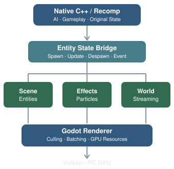

# Architecture

The Godot MVP uses one game implementation, imported from the Windows source
distribution at `D:/dev/hp2_ps2_rev`.

| Diagram layer | Ownership |
| --- | --- |
| Native C++ / Recomp | `src/game_core` owns original game logic and state, including AI, physics, collisions, race rules, menus, saves, replay, audio scheduling, and effect triggers. |
| Entity State Bridge | `src/mvp/bridge` carries committed state and ordered events. Godot uses World generation and source IDs to reconcile spawn, update, and despawn. Host input goes back through `ApplicationRuntime` to the original handlers. |
| Scene, Entities, Effects / Particles, World / Streaming | `src/mvp/systems` and `godot_mvp` own presentation and its lifetimes. Godot creates and retires scene nodes, vehicle visuals, particles, and streamed presentation resources from the original state and assets. Godot also manages UI, animation, and audio playback. |
| Godot Renderer | Godot owns culling, batching, shaders, and GPU resources. The diagram shows the default Vulkan path. The Windows launcher also supports D3D12 Forward+. |

## Shader resources and scene buffers

Author MVP shaders in Godot Shader Language under
[`src/mvp/shader`](../src/mvp/shader). Name resources by effect. The staging
target copies them to `res://shader/`, and the MVP loads them as Godot Shader
resources. C++ owns material parameters, viewport order and resource lifetimes.

The race and track viewer render into a dedicated Forward+ viewport. A
post-transparent compositor callback exposes resolved color and reverse-Z
depth to the Godot canvas passes. Forward+ resolves depth into a sampleable
R32 texture with 2× MSAA enabled on the source viewport. Fog and focus use
the source viewport's depth. The output is composed below the HUD and
history uses separate alternating render targets. A size change invalidates
history and the borrowed scene-buffer bindings.

Vehicle materials consume original strip normals, light material coefficients,
light contexts and decoded textures. Godot uses the donor environment camera
schedule and remap samples to render the six race reflection faces and the
reflection atlas. Frontend previews sample the original CarSelectEnvMap.

## Game Core Integration Boundary

Preserve the donor and reverse-engineered code in `src/game_core` by default.
Core changes require an evidence-backed correction to original behavior or a
required integration capability that the existing interfaces cannot supply.
Keep the boundary in C/C++ and use the smallest interface that exposes the
required committed state, original input entry point, or generic lifecycle
callback. Record the justification, evidence and checks in the task record.
See [Game Core Change Rules](../AGENTS.md#game-core-change-rules).

The host handles explicit diagnostic requests. MVP adapters in
`src/mvp/assets` own diagnostic selection, test unlocks, forced triggers,
debug UI and diagnostic state collection. C++ tests and AI driving helpers
live in `src/mvp/tests`. Smoke and batch validation scripts live in `tools`.
Diagnostics that change progression or race state default to an isolated
test profile.

For `--race-event=<tree>:<id>`, the Godot launcher parses the arguments
and passes the request to the MVP. `ApplicationRuntime` invokes a generic
host startup callback once the authored frontend banks are ready.
[`race_diagnostics.cpp`](../src/mvp/assets/race_diagnostics.cpp) resolves
the event, selects the first authored allowed car and calls the original
event setup and race start. The Entity State Bridge publishes committed
World state and ordered events to Godot, which owns presentation resources
and their lifetimes.

## Race entry

The default project entry runs the Godot frontend. The explicit `--race-track=<id>`
entry validates the ID against the authored scenario catalogue and starts
the donor's single-player Quick Race in skip-start-sequence mode. The donor services original assets,
input, rules, audio, physics and AI. Its state-only update returns before
Ecstasy draw capture and submission.

Normal campaign progression controls menu admission.

Entity State Bridge copies the committed vehicle and wheel poses, speed,
visibility and primary camera. It identifies each publication by World
generation, step and replay restore epoch, and each car by its World-issued handle. Godot creates
track meshes from decoded authored placements and car meshes from decoded
model assets. The shared mesh converter uploads authored RGB555 vertex
colors for the track, sky, vehicles and frontend previews. Godot's unshaded
standard material multiplies the vertex color by the albedo texture.
These reads finish synchronously before the next World step.
The scene tree owns the nodes. Godot resource references retain meshes and
textures. Godot applies the camera and vehicle transforms from the same
snapshot and releases nodes when their handles or generation retire.

The committed WorldObject list feeds Godot meshes for roadblocks,
spike strips, helicopters, munitions and other dynamic props. The original
owners publish model, pose and visibility. Godot shares uploaded meshes
and reconciles node lifetimes with the race scene.

Race effects use the same scene lifetime. AcidFX publishes ordered births,
steps and removals from its original shared pools. Godot runs motion and
draws billboards in GPUParticles3D nodes shared by effect definition. The
native skid, lamp and sun owners publish authored geometry and parameters.
Godot owns the road meshes, light billboards and sun depth sampling.

The donor Player and RaceCoordinator provide the HUD and race screens.
Be the Cop uses the donor's pursuit state to select the authored police HUD
and single-player police results. Godot sends host keyboard input through
the original controller scanner, including the police support chords.
Unsupported entries and invalid integration data emit `HP2_MVP_ASSERT`
with the stage, track and reason and stop the run with exit code 1.

[The implementation record](../tasks/active/TASK-0124-modular-godot-presentation.md)
documents the Forward+ drive and open presentation work.

Godot uploads scenery vertex and rigid animation frames with the track mesh.
Forward+ samples them with the shared source clock, including UV scrolling
and texture sequences. The same scene still submits authored emitter events
to the Godot particle system.

The race camera runs source fog, focus, colour and history effects in a
Forward+ compositor after transparent 3D draws and before the HUD. The
renderer owns GPU history and focus textures. Race state supplies effect
operands and replay discontinuities.

## Frontend

The donor menu, profile, Player and RaceCoordinator owners provide state.
Flailer resolves authored glyphs, kerning, clipping, bitmap UVs and layer
order, including the event tree's dynamic elements and the race HUD.
Godot synchronously consumes the CPU layout and requests decoded pixels
from game_core's shared resource decoder. Godot CanvasItems own 2D drawing,
ImageTextures hold the uploaded images, and SubViewports present previews.
A Godot Tween handles screen fades and the selected item's echo, using
the authored start pose, scale ratio, alpha and period from Flailer.
Some authored animation values still come from Flailer and Player clocks.
The same canvas survives race entry, pause, and the return to the frontend.
The donor selects the event's track and direction and validates the track
against the authored catalogue at handoff and continuation. The state-only
host admits single-player presentation. A traffic car can change its skin while keeping its World
handle. Godot replaces its visual node when the committed appearance changes.
The donor supplies the minimap geometry and homogeneous texture coordinates.
The Godot canvas shader interpolates those coordinates before sampling the
road texture so it shares the marker projection in tilted modes.
Godot fits the authored 640×480 menu and HUD canvas uniformly inside the
live viewport. It tiles the authored grid at the same scale beyond the
canvas and fits video at 4:3. The race camera retains vertical framing
and renders the scene across the full viewport.
Frontend 3D previews render at the fitted canvas's pixel dimensions
and composite into their authored 4:3 rectangle. Clipped grid fragments
retain their original geometry.
Select Car uses the same unshaded texture and vertex color material
as race vehicles, including donor-resolved lamp texture bindings.

The title movie owner publishes a resource path and request ID. Godot's
VideoStreamPlayback backend gives FFmpeg a seekable view of the original AVI
inside the game resource. FFmpeg decodes MV30 as playback advances. Godot
presents the decoded planes and acknowledges the request at EOF. The
existing PS2 ADPCM decoder handles title audio mislabeled as PCM, and
the playback backend submits it to the Godot audio mixer.
