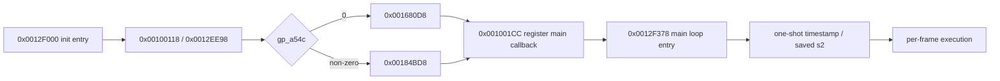
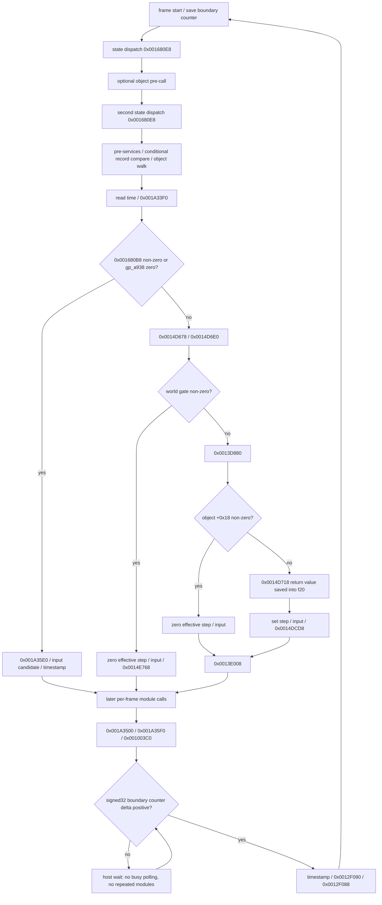
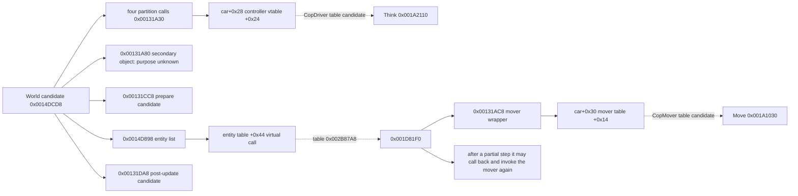

# TASK-0010: main loop structure and module attachment

Completed 2026-10-12, Australia/Sydney. The scope delivered is **an evidenced dispatch structure
and a testable skeleton**; module internals, original runtime behaviour and complete types are
still unrecovered.

Binary: `SLUS_203.62`, SHA-256
`7335b8ed479481082c648958f4b5be4da65b74d042d0ab2f5237df801eafacc2`.
USA/NTSC inferred; the actual executable revision is unknown, the boot file says VER 1.00.
Ghidra 12.0.4, `r5900:LE:32:default` / default. The read-only review of 51 functions changed no
names, prototypes or boundaries.

## Startup and per-frame flow

Of the five static call sites in the startup function `0x0012F000`, every path executes four:
initialise, bootstrap, one of two initial state paths, and the main callback registration.
`gp_a54c` is read **after** bootstrap runs.
The registration call site `0x0012F064` passes `a0=0x0012F378, a1=0x70004000, a2=0, a3=0`; the
full thread/ABI semantics are not established.
The timing call at the main loop entry `0x0012F3A0` executes exactly once.



The main loop has **61 call sites across 39 distinct targets**. All of them are recorded in
`reverse/main_loop/call_sites.csv`, including the repeated timing calls, the two state dispatches
and the input calls in mutually exclusive branches. The CSV keeps arguments, unknown original
names, purpose confidence and evidence IDs; the 12 normalised gating conditions are in
`branches.csv`. True/false in that condition table is normalised logic and is not the same thing
as whether the original instruction branched.



`0x0012F190` is a record/compare candidate, not a World update. The kind of object behind
`gp_a938` is unknown, so it must not simply be renamed "world"; `gp_a998` is the world object
candidate. The full ordering of later calls follows the call-site inventory and the manually
checked tests, and is deliberately not reordered into a generic "input → physics → render" shape.

## World internal connections

`0x0014DCD8` contains car controller walks over several partitions, other vehicle phases, entity
virtual calls and post-update steps. The numeric ranges of the partitions are recorded; what the
partitions mean is unknown. It is kept here as a single top-level World handler, and the entity
walk is **not flattened into a fixed single Move**.



The 19 direct, virtual and tail-jump connections are in
`reverse/main_loop/world_connections.csv` and `world_connections.hpp`.
The controller virtual call keeps its `this` adjustment; the mover's second call uses
`dt - the returned f0`.
`0x00131A80` calls the secondary object at car `+0x2C`, not the mover at `+0x30`.
`0x00131CC8` has a tail connection jumping to `0x001C0850`, so counting JALs alone is not enough.
These are static connection facts; they do not prove runtime object types, collision semantics or
behavioural equivalence.

## The native interface and module extension

The core lives in `src/game_core/engine/`, stays independent of Godot and uses C++17:

| Interface | Responsibility |
|---|---|
| `EngineShell::initialize()` | the startup path and the one-shot main loop timing; host-driven, replacing the original threading |
| `step_frame(HostFrameEvent)` | run one frame or resume a pending one; returns Completed / Waiting / Unimplemented / Error |
| `shutdown()` | a host-side cancel; it does not claim an original shutdown was found |
| `FrameContext` / `FrameTrace` | port-side copies of the raw gating fields, timing, call locations, evidence, unrecovered items and errors |
| `ModuleRegistry::bind_site()` | a handler for one specific call site, taking priority over a target-address binding |
| `bind_target()` | a shared handler for every call site of one function, also usable as an attachment slot for future modules |
| `world_connections()` | the known nested connection metadata; it does not automatically run the car/entity loops |

Non-zero object values in `RawState` are observation-mode tokens, not host pointers or valid PS2
objects. Strict mode requires the caller to supply real data adapters and handlers.
`CallArguments` keeps the `a0..a3` / `f12` values that could be confirmed; unconfirmed registers
stay as empty optionals, are never filled in with 0, and are never used to guess an original
prototype.
A callback must supply the callee's result and any relevant global side effects; it stops when a
consumed return value or timing datum is missing.
The privately saved `s2` timestamp and `f20` world step are not overwritten by another handler's
changes to the global timing copies.

Attaching a module:

```cpp
shell.modules().bind_target(0x0014DCD8,
    [&world](hp2::engine::FrameContext& frame,
             const hp2::engine::CallSite& site,
             const hp2::engine::CallArguments& args) {
        // `world` is a future module with evidence and tests behind it; an empty implementation
        // must never be used to claim recovery.
        return world.step(frame, site, args);
    });
```

Later modules should live in directories named after the subsystems actually recovered, such as
`game_core/world/`, `input/` and `presentation/`. Lifetime, state and time dispatch currently sit
in engine; unknown services stay in `UnresolvedCalls`. The order for adding a module is: create
the address/structure records → confirm the ABI and arguments → implement and test → register the
handler → add a dispatch regression test. When World's internals are recovered, respect the
original entity counts, partitions and indirect dispatch; do not force a CopDriver/CopMover
binding onto every car.

Mode and trace semantics:

- **Observation**: an unbound function is a yellow synthetic placeholder that only records and
  provides an explicit fixture. `base_step=0.02` and `effective_step=0.01` are test values, not
  the original frequency or physics constants. A custom handler installed at initialise can still
  override the slot.
- **Strict**: a missing handler returns Unimplemented; an exception, a failure or a missing
  required result returns Error. A failure keeps its prefix and location, later steps do not retry
  automatically, and initialise must be run again after a fix.
- Executed means the handler call returned; the result contract is still checked afterwards, and
  an Error for the same call site may follow immediately. It does not mean the original behaviour
  was verified.
- A trace covers the current frame only; the startup trace is separate. Pausing is the host
  declining to step; waiting does not repeat modules and does not grow the record without bound.

## The Godot observer page and how to run it

A new scene `godot/scenes/main_loop_observer.tscn` was added; the original `main.tscn`, the
PortCore methods and the project's default entry point are untouched.
MainLoopObserver is a separate bridge class and does not depend on the old synthetic demo's
fixed-step dispatch.

```powershell
# build and open, first time or after a source change
./tools/run_main_loop_observer.ps1 -Build
# open using the current DLL
./tools/run_main_loop_observer.ps1
# headless acceptance
./tools/run_main_loop_observer.ps1 -Smoke
```

The page offers Start / Pause / Single frame / Reset / Stop. With "Synthetic boundary" turned off,
single-stepping stops at the frame boundary and "Send boundary" only resumes a waiting frame. Six
scenarios cover the world update, no object, the world gate, the record field branch, the state
predicate branch, and record compare with the optional callback suppressed. The Startup and World
connections tabs show the startup and nested connections.
Strict mode ships with no built-in game handlers, so it immediately names the first unrecovered
startup call rather than pretending the game started.

The original busy-wait checks a signed-positive condition on a 32-bit wrapping difference. The
port keeps the comparison and advances the counter from host boundary events; by default each
`_process` sends one **synthetic** event. The host delta is recorded for observation only and does
not replace the game step. No fixed 60 Hz is inferred, no threads are added, and nothing is
delegated to Godot physics.

## Evidence, validation and gaps

- E-0010-01: the full main-loop disassembly/pseudocode and its 61 call sites.
- E-0010-02: bootstrap, arguments, the dynamic startup gate and the entry timing.
- E-0010-03: World, the car wrapper, entity construction/vtable, virtual calls and tail
  connections.
- E-0010-04: independent manual sequences, strict contracts, dynamic gating, saved registers,
  wait/resume/wrap and error tests.
- E-0010-05: the Godot scene/bridge headless tests, the old demo tests and a real screenshot.

The private evidence under `ps2_decomp/main-loop/` keeps the 51 function probes, file SHA-256
values, call sites, tool versions, and `validation.json` with the exact test commands and results.
`collect_main_loop.py` reuses existing exports with the same metadata;
`validate_main_loop.py --metadata-only` can check the shared manifest in an environment without
the original ELF or MCP; the full validator additionally checks the live MCP metadata, the
original ELF and all 19 connection instructions.

```powershell
py -3 reverse/scripts/collect_main_loop.py
py -3 reverse/scripts/validate_main_loop.py
cmake --preset native-debug
cmake --build --preset native-debug
ctest --preset native-debug
cmake --preset godot-debug
cmake --build --preset godot-debug --parallel 4
ctest --preset godot-debug
```

The staged, parallel question review and evidence classification process of the
[REA skill](C:/Users/nurupo/.agents/skills/reverse-engineer-anything/SKILL.md) v37 was used. No
REA MCP registration or usable CLI is present, so the actual binary analysis went through the
existing Ghidra MCP; E-0010 is a project evidence ID and does not pose as an REA server Evidence
reference. No registration configuration was changed and no other tools were installed.

The first Godot test surfaced the new extension classes being registered twice at a non-SCENE
initialisation level; after the fix the log is ERROR-free and the test passes again. Native and
bridge CTest both 6/6, the six-scenario observer smoke, the old demo smoke and a real 1380x900
page screenshot all pass. Tools: GCC 13.2.0, Python 3.14.4, CMake 3.29.2,
Godot 4.3.stable.official.77dcf97d8; the binding pins are unchanged.
The screenshot is in the ignored `local/main-loop-observer.png`. There is no Git commit, no Ghidra
name/type/boundary change and no promotion to Verified.

Remaining gaps: original identifiers and the full ABI, global object/state enums, the state
callback registry, the real clock/step/boundary sources, module internals, and any comparison
against the original running. The next task should recover World's object/partition and entity
loop contracts and then attach the first module with behavioural evidence to the Registry;
TASK-0009's full recovery is still incomplete.
