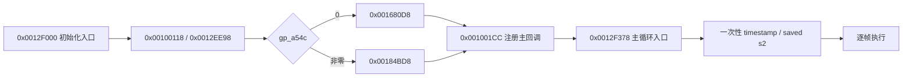
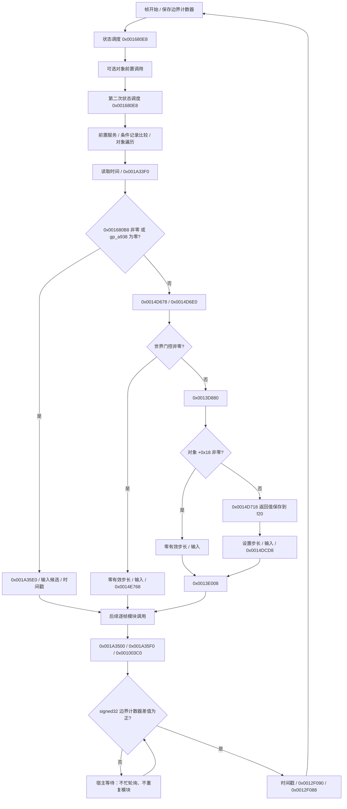
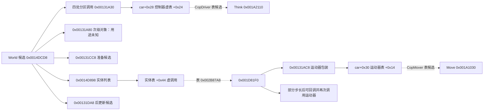

# TASK-0010：主循环结构与模块接入

完成日期：2026-10-12，Australia/Sydney。完成范围是**有证据的调度结构和可测试骨架**；模块内部、原版运行效果及完整类型仍未恢复。

二进制：`SLUS_203.62`，SHA-256
`7335b8ed479481082c648958f4b5be4da65b74d042d0ab2f5237df801eafacc2`。
USA/NTSC 推断；实际可执行文件修订版 unknown，启动文件 VER 1.00。
Ghidra 12.0.4，`r5900:LE:32:default` / default。51 个函数的只读核对未改变名字、原型或边界。

## 启动和逐帧流程

启动函数 `0x0012F000` 的五个静态调用点中，每条路径执行四个：初始化、bootstrap、二选一的初始状态路径、主回调注册。`gp_a54c` 在 bootstrap **执行后**读取。
注册调用点 `0x0012F064` 的参数为 `a0=0x0012F378, a1=0x70004000, a2=0, a3=0`；完整线程/ABI 语义未建立。
主循环入口 `0x0012F3A0` 的计时调用只执行一次。



主循环有 **61 个调用点、39 个不同目标**。全部记录在 `reverse/main_loop/call_sites.csv`，包括重复计时、两次状态调度和互斥分支中的输入调用。CSV 保留参数、未知原名、用途置信度和证据 ID；12 个规范化门控条件见 `branches.csv`。条件表的 true/false 是规范化逻辑，不等同于原指令是否跳转。



`0x0012F190` 是记录/比较用途候选，不是 World 更新。`gp_a938` 的对象种类未知，不能把它直接改名为 world；`gp_a998` 是世界对象候选。完整后续调用顺序以调用点清单和人工核对测试为准，不按“输入→物理→渲染”的通用顺序重排。

## World 内部连接

`0x0014DCD8` 有多个分区的车辆控制器遍历、其他车辆阶段、实体虚调用及后更新步骤。分区的数值范围已记录，分区含义未知。这里保留为一个顶层 World handler；**不把实体遍历摊平成固定的一次 Move**。



19 个直接、虚调用和尾跳连接见 `reverse/main_loop/world_connections.csv` 和 `world_connections.hpp`。
控制器虚调用保留 `this` 调整；运动器第二次调用使用 `dt - 返回的 f0`。
`0x00131A80` 调用车上 `+0x2C` 的次级对象，不是 `+0x30` 的运动器。
`0x00131CC8` 有跳至 `0x001C0850` 的尾连接，不能仅统计 JAL。
这些是静态连接事实，不能证明运行时对象类型、碰撞语义或行为等价。

## 原生接口及模块扩展

核心位于 `src/game_core/engine/`，继续独立于 Godot，使用 C++17：

| 接口 | 职责 |
|---|---|
| `EngineShell::initialize()` | 启动路径及一次性主循环计时；宿主驱动取代原线程机制 |
| `step_frame(HostFrameEvent)` | 执行一帧或恢复待完成帧；返回 Completed / Waiting / Unimplemented / Error |
| `shutdown()` | 宿主取消操作，不声称找到了原版 shutdown |
| `FrameContext` / `FrameTrace` | 原始门控字段的移植副本、计时、调用位置、证据、未恢复项及错误 |
| `ModuleRegistry::bind_site()` | 单个调用点的处理器，优先于目标地址绑定 |
| `bind_target()` | 同一函数多个调用点的公共处理器，也可作为未来模块的连接槽 |
| `world_connections()` | 已知嵌套连接元数据，不自动执行车辆/实体循环 |

`RawState` 的非零对象值是观察模式 token，不是宿主指针或有效 PS2 对象。严格模式由调用者提供真实数据适配器和处理器。
`CallArguments` 保存可确认的 `a0..a3` / `f12` 值，未确认的寄存器是空 optional，绝不补成 0，也不据此猜测原版函数原型。
回调必须提供被调用者结果及相关全局副作用；被消费的返回值或时间数据缺失时停止。
私有保存的 `s2` 时间戳和 `f20` 世界步长不会被其他 handler 对全局计时副本的修改覆盖。

模块接入示例：

```cpp
shell.modules().bind_target(0x0014DCD8,
    [&world](hp2::engine::FrameContext& frame,
             const hp2::engine::CallSite& site,
             const hp2::engine::CallArguments& args) {
        // world 是未来有证据和测试的模块；不能用空实现宣称已恢复。
        return world.step(frame, site, args);
    });
```

后续模块建议放在 `game_core/world/`、`input/`、`presentation/` 等实际恢复的子系统目录。生命周期、状态和时间调度目前集中在 engine；未知服务留在 `UnresolvedCalls`。增加模块时：建立地址/结构记录 → 确认 ABI/参数 → 实现并测试 → 注册 handler → 加入调度回归测试。World 内部恢复时遵守原实体数量、分区和间接分派，不强制为所有车辆绑定 CopDriver/CopMover。

模式和追踪语义：

- **Observation**：未绑定的函数是黄色合成占位，仅记录并提供显式 fixture。`base_step=0.02`、`effective_step=0.01` 是测试值，不是原频率或物理常数。初始化自定义 handler 仍可以覆盖槽位。
- **Strict**：缺失 handler 返回 Unimplemented；异常、失败或所需结果缺失返回 Error。失败保留前缀和位置，后续 step 不自动重试；修复后重新 initialize。
- Executed 表示 handler 调用返回，后续仍须通过结果契约校验；可能随即出现同调用点 Error。它不表示原版行为已验证。
- 追踪只保留当前帧；启动追踪独立。暂停由宿主停止 step；等待不重复模块，不无限增加记录。

## Godot 观察页和运行方式

新增场景 `godot/scenes/main_loop_observer.tscn`，原 `main.tscn`、PortCore 方法和项目默认入口保留。
MainLoopObserver 是独立桥接类，不依赖旧合成 demo 的固定步长调度。

```powershell
# 首次或源码改变后编译并打开
./tools/run_main_loop_observer.ps1 -Build
# 使用当前 DLL 打开
./tools/run_main_loop_observer.ps1
# 无界面验收
./tools/run_main_loop_observer.ps1 -Smoke
```

页面可 Start / Pause / Single frame / Reset / Stop；关闭 Synthetic boundary 后单步会停在帧边界，Send boundary 仅恢复等待帧。六种场景覆盖世界更新、无对象、世界门控、记录字段分支、状态谓词分支、记录比较/可选回调抑制。Startup 和 World connections 页签显示启动及嵌套连接。
Strict 模式没有内置游戏处理器，立即指出第一个未恢复的启动调用，而不是假装游戏启动成功。

原忙等待检查的是 32 位回绕差值的有符号正数条件。移植保留比较，采用宿主边界事件推进计数器；默认每次 `_process` 发一个**合成**事件。宿主 delta 只作观察记录，不替代游戏步长。不推断固定 60 Hz，不新增线程，不委托 Godot 物理。

## 证据、验证和缺口

- E-0010-01：主循环完整反汇编/伪代码及 61 个调用点。
- E-0010-02：bootstrap、参数、动态 startup gate 和入口计时。
- E-0010-03：World、车辆包装、实体构造/vtable、虚调用和尾连接。
- E-0010-04：独立人工序列、严格契约、动态门控、保存寄存器、等待/恢复/回绕及错误测试。
- E-0010-05：Godot 场景/桥接无界面测试、旧 demo 测试和实际渲染截图。

私有证据 `ps2_decomp/main-loop/` 保存 51 个函数 probes、文件 SHA-256、调用点、工具版本和 `validation.json` 的精确测试命令/结果。
`collect_main_loop.py` 复用相同元数据的已有导出；`validate_main_loop.py --metadata-only` 可在没有原 ELF/MCP 的环境检查共享清单；完整 validator 还核对实际 MCP 元数据、原 ELF 和所有 19 个连接指令。

```powershell
py -3 reverse/scripts/collect_main_loop.py
py -3 reverse/scripts/validate_main_loop.py
cmake --preset native-debug
cmake --build --preset native-debug
ctest --preset native-debug
cmake --preset godot-debug
cmake --build --preset godot-debug --parallel 4
ctest --preset godot-debug
```

使用了 [REA skill](C:/Users/nurupo/.agents/skills/reverse-engineer-anything/SKILL.md) v37 的分阶段、并行问题审查和证据分类流程。当前没有 REA MCP 注册或可用 CLI，实际二进制分析通过已有 Ghidra MCP 完成；E-0010 是项目证据 ID，不冒充 REA 服务器 Evidence。没有更改注册配置或安装其他工具。

首次 Godot 测试发现新扩展类在非 SCENE 初始化阶段重复注册；修复后日志无 ERROR，重新通过。原生与桥接 CTest 各 6/6、六场景 observer smoke、旧 demo smoke、实际 1380×900 页面截图均通过。工具为 GCC 13.2.0、Python 3.14.4、CMake 3.29.2、Godot 4.3.stable.official.77dcf97d8；绑定 pin 未变。
截图在 ignored `local/main-loop-observer.png`。没有 Git commit、Ghidra 名称/类型/边界修改或 Verified 提升。

剩余缺口：原始标识和完整 ABI、全局对象/状态枚举、状态回调注册表、真实 clock/步长/边界来源、模块内部及原版运行对照。下一任务应恢复 World 的对象/分区和实体循环契约，随后在 Registry 中接入第一个有行为证据的模块；TASK-0009 的全量恢复仍未完成。
